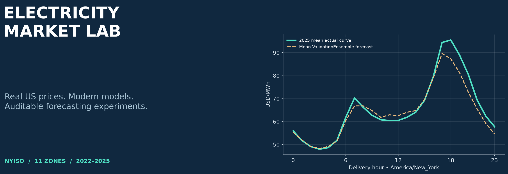
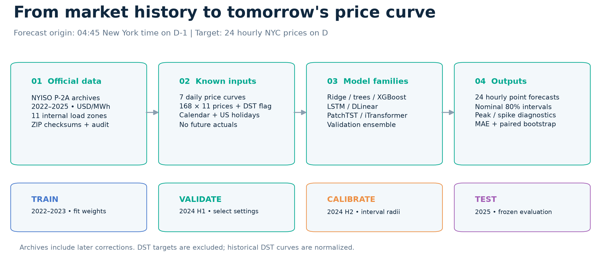
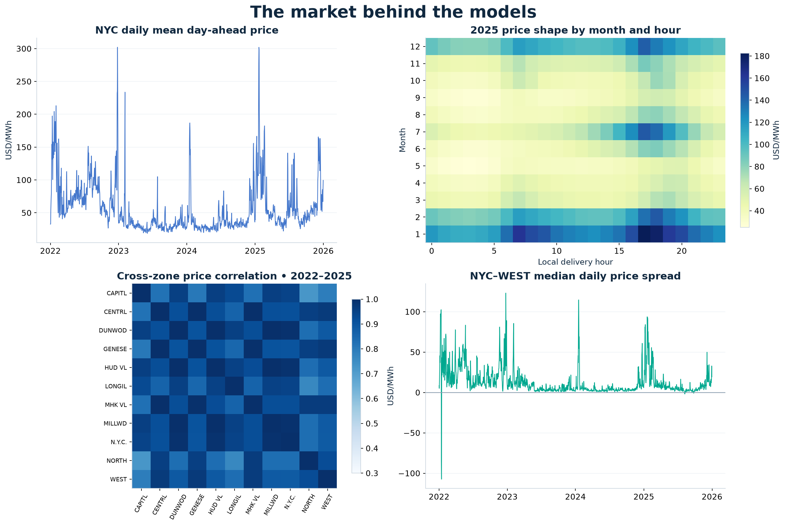
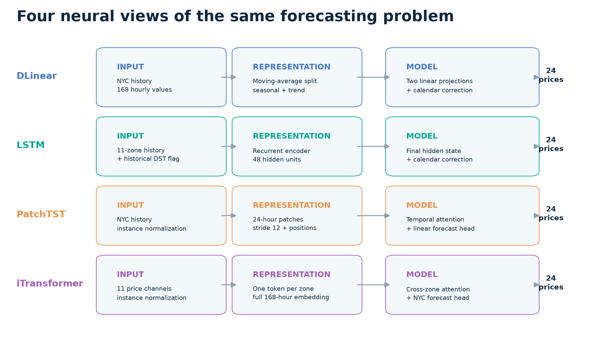
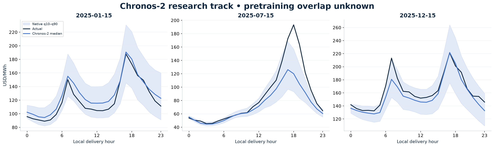
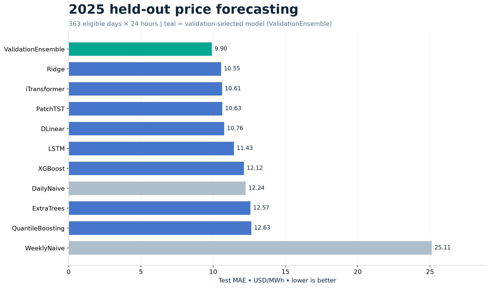
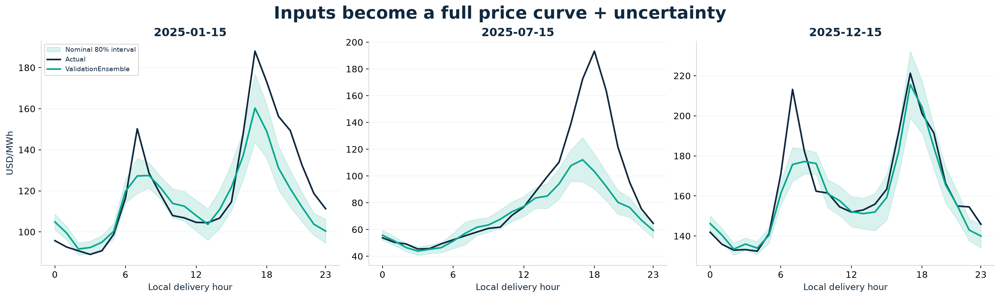
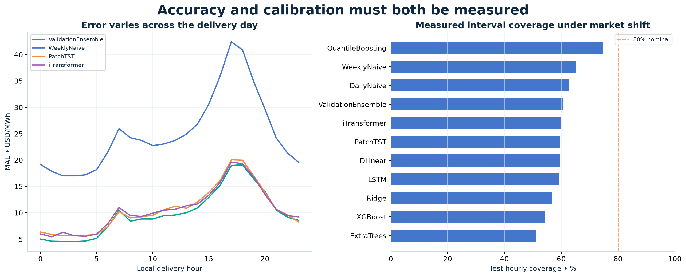

<p align="center"></p>

# Electricity market modeling and analysis

[](https://github.com/BehnamMohseniGharyehsafa/electricity-market-modeling-and-analysis/actions/workflows/ci.yml)


**Predict a full day of wholesale electricity prices before the auction.** A reproducible
US electricity-market research project combining classical machine learning, modern neural
forecasting, probabilistic calibration, and a separate foundation-model experiment.

Built and maintained by **Behnam Mohseni Gharyehsafa**.

> This repository reports computed results, including weak models and failed interval
> coverage. It does not claim universal state of the art, perfect accuracy, or trading profit.

## At a glance

| Real market data | Forecast | Validation |
|---|---|---|
| NYISO, 11 internal zones, 2022–2025 | Tomorrow's 24 NYC hourly LBMPs, USD/MWh | Train / validation / calibration / held-out test |
| 385,704 source observations; 48 monthly ZIP archives | 7 daily price curves + calendar; before 05:00 auction close | 363 test days; 8,712 hourly targets |

**What makes the project useful:** official downloadable data with checksums; eleven tested
baseline/ML/deep-learning/ensemble methods; current Chronos-2 integration; transparent
auction timing; DST-aware data handling; calibrated intervals; and figures generated from
the saved experiment rather than fabricated examples.



## Real US data — links included

The source is the **New York Independent System Operator's P-2A day-ahead zonal LBMP**:

- [Official archive index](https://mis.nyiso.com/public/P-2Alist.htm)
- [Current NYISO portal](https://oasis.nyiso.com/DAM_LBMP_ZONE)
- [Download an example: January 2024 ZIP](https://mis.nyiso.com/public/csv/damlbmp/20240101damlbmp_zone_csv.zip)
- [All 48 exact URLs, byte sizes and SHA-256 fingerprints](reports/data_manifest.json)
- [Data card: units, zones, timing, DST and limitations](docs/DATA_CARD.md)

The downloader fetches real prices directly from NYISO without an API key. Source data
stays local; this repository includes code, provenance, aggregate scores and research figures.
The MIT license applies to original project code/documentation, not NYISO source data or
third-party pretrained weights. No synthetic data is substituted in the published experiment.



## Models, inputs and outputs

| Family | Methods | Inputs → outputs |
|---|---|---|
| Seasonal references | DailyNaive, WeeklyNaive | Previous day/week NYC curve → 24 prices |
| Regularized ML | Ridge | Lagged curves, spatial summaries, calendar → 24 prices |
| Tree ensembles | ExtraTrees, XGBoost | Lagged curves, spatial summaries, calendar → 24 prices |
| Recurrent / decomposition | LSTM, DLinear | Multizone sequence / NYC decomposition → 24 prices |
| Attention-based DL | PatchTST, iTransformer | Temporal patches / cross-zone tokens → 24 prices |
| Probabilistic ML | QuantileBoosting + CQR | Hourly lag/spatial/calendar features → median and interval |
| Ensemble | ValidationEnsemble | Three models chosen using validation only → weighted curve |
| Foundation model, separate track | Chronos-2 (120M pretrained parameters) | NYC + past spatial covariates → native quantile forecasts |

Every supervised point model also receives separate per-hour split-conformal intervals.
The neural implementations are compact adaptations, with architectural differences and
training settings documented in the [methodology](docs/METHODOLOGY.md).



## Measured results

The full-year test is **2025**. Model weights are fitted on 2022–2023; settings and neural
epochs use 2024 H1; intervals use 2024 H2. No refitting on test labels is performed.
All eight DST transition days across the source period are excluded as targets; historical
DST curves are normalized and flagged. Negative prices are preserved.

| Model | MAE ↓ | RMSE ↓ | Skill vs weekly ↑ | 80% interval coverage |
|---|---:|---:|---:|---:|
| **ValidationEnsemble** | 9.90 | 18.78 | 60.6% | 60.7% |
| Ridge | 10.55 | 19.14 | 58.0% | 56.6% |
| iTransformer | 10.61 | 19.45 | 57.8% | 59.8% |
| PatchTST | 10.63 | 19.77 | 57.7% | 59.6% |
| DLinear | 10.76 | 19.89 | 57.2% | 59.5% |
| LSTM | 11.43 | 21.46 | 54.5% | 59.1% |
| XGBoost | 12.12 | 21.76 | 51.7% | 54.2% |
| DailyNaive | 12.24 | 23.53 | 51.3% | 62.7% |
| ExtraTrees | 12.57 | 21.67 | 50.0% | 51.0% |
| QuantileBoosting | 12.63 | 24.58 | 49.7% | 74.6% |
| WeeklyNaive | 25.11 | 46.85 | 0.0% | 65.3% |

MAE/RMSE are USD/MWh. Bold identifies the **validation-selected** model, not a model
selected after viewing test scores. ValidationEnsemble achieves a test MAE of
**9.90 USD/MWh**, versus WeeklyNaive, with a paired seven-day-block
bootstrap MAE difference of **-15.21**
(95% descriptive interval **[-21.27, -9.78]**).
The nominal 80% interval achieved **60.7%** hourly coverage.
Time dependence and regime shifts limit conformal coverage guarantees.

Chronos-2 also ran on **363 days** (all eligible 2025 delivery days): MAE **10.32 USD/MWh**, native interval coverage **69.5%**. Its public pretraining overlap is unknown, so it is **reported separately** and excluded from supervised model selection. [Exact record and pinned checkpoint](reports/foundation_experiment.json).









Explore [all metrics](reports/metrics.csv), [daily paired losses](reports/daily_mae.csv),
[hourly errors](reports/hourly_mae.csv), [run settings and versions](reports/run.json),
and the [research interpretation](docs/RESULTS.md).

Verification: `pytest -q` covers data contracts, future-input isolation, scoring, neural
gradients and inference inputs. `python scripts/verify_artifacts.py` reloads the fitted
models and compares their forecasts and calibrated bounds to the saved backtest.

## Reproduce locally

Python 3.11–3.13. The recorded run uses Python 3.12.14 on CPU.

```bash
git clone https://github.com/BehnamMohseniGharyehsafa/electricity-market-modeling-and-analysis.git
cd electricity-market-modeling-and-analysis
python -m venv .venv
# macOS/Linux:
source .venv/bin/activate
# Windows PowerShell: .\.venv\Scripts\Activate.ps1
python -m pip install -e '.[dev]'
electricity-lab all --epochs 100 --seed 42
pytest -q
ruff check .
```

Alternatively run stages individually:

```bash
electricity-lab download
electricity-lab benchmark --epochs 100 --seed 42
electricity-lab figures
python scripts/write_readme.py
```

Reload the saved validation-selected model and write an actual 24-row forecast CSV:

```bash
electricity-lab forecast --date 2025-01-15
# Also supports 2026-01-01 using only the final seven published 2025 curves.
```

Forecast files are saved locally under `artifacts/`. Inference requires no target-day
prices; serialization round-trip checks are recorded in [the artifact audit](reports/artifact_audit.json).
The forecast intervals retain the measured calibration limitations described above.
For the guided notebook, install `python -m pip install -e '.[notebook]'` and open
[`notebooks/01_research_walkthrough.ipynb`](notebooks/01_research_walkthrough.ipynb).

Archives total only a few MB; training requires scientific Python/PyTorch packages and
several minutes on a modern CPU. The supplied [environment lock](requirements-lock.txt)
captures the actual run, including optional foundation packages. Editable project metadata
is excluded from that lock: install `-e .` separately after installing it. Exact numerical
results can vary across hardware/library versions. ZIP corrections can change future reruns;
compare the recorded source hashes.

For the advanced foundation-model track:

```bash
python -m pip install -e '.[foundation]'
python -m electricity_market.foundation --full-test --revision 29ec3766d36d6f73f0696f85560a422f50e8498c
# Omit --revision to resolve and record the current official weight revision.
# Without --full-test, run only the 12 illustrative monthly 15th-day examples.
python scripts/write_readme.py
```

The first foundation run downloads official model weights (hundreds of MB). Pretraining
overlap is unknown, so those results remain separate from the supervised leaderboard.

## Repository guide

```text
src/electricity_market/   Download, features, model training, scoring, charts, CLI
tests/                   Data contracts, leakage tests, scores, neural backward passes
docs/                    Data card, methodology, interpretation, model card and figures
reports/                 Provenance, aggregate metrics and exact run metadata
notebooks/               Guided research walkthrough (no invented output cells)
scripts/                 Documentation generation
data/                    Local-only raw archives and processed arrays
artifacts/               Local-only fitted models and row-level backtest arrays
.github/workflows/       Python 3.11/3.12 CI checks
```

## Limits and next research steps

NYISO archives contain later price corrections; this is not a historical release-vintage
simulation. The benchmark covers one US market and one target zone, has two training
years, one full test year and one random seed. It does not model realized demand, market
clearing, bid curves, dispatch, or profits. Non-24-hour targets are excluded. Weather/load/gas
forecast vintages, multi-zone targets, adaptive calibration, rolling retraining, multiple seeds
and a newer untouched holdout are natural extensions. See the
[model card](docs/MODEL_CARD.md) and [contributing guide](CONTRIBUTING.md).

## Research references

[DLinear](https://arxiv.org/abs/2205.13504) ·
[PatchTST](https://arxiv.org/abs/2211.14730) ·
[iTransformer](https://arxiv.org/abs/2310.06625) ·
[Conformalized Quantile Regression](https://arxiv.org/abs/1905.03222) ·
[Chronos-2](https://arxiv.org/abs/2510.15821)

Original code and documentation: MIT. See [LICENSE](LICENSE) and [citation metadata](CITATION.cff).
